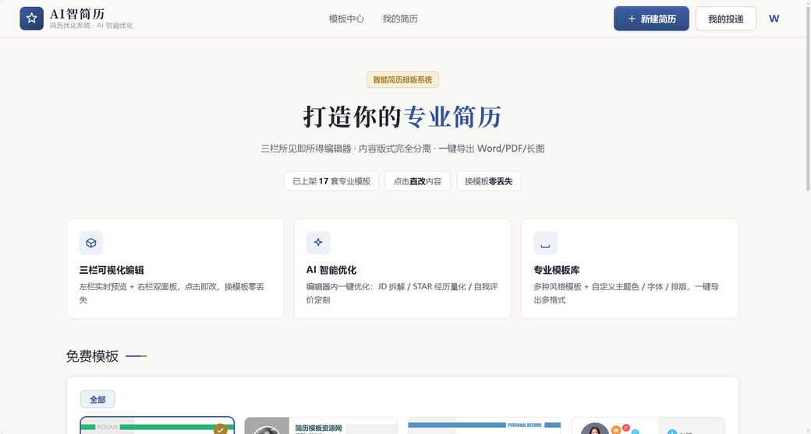
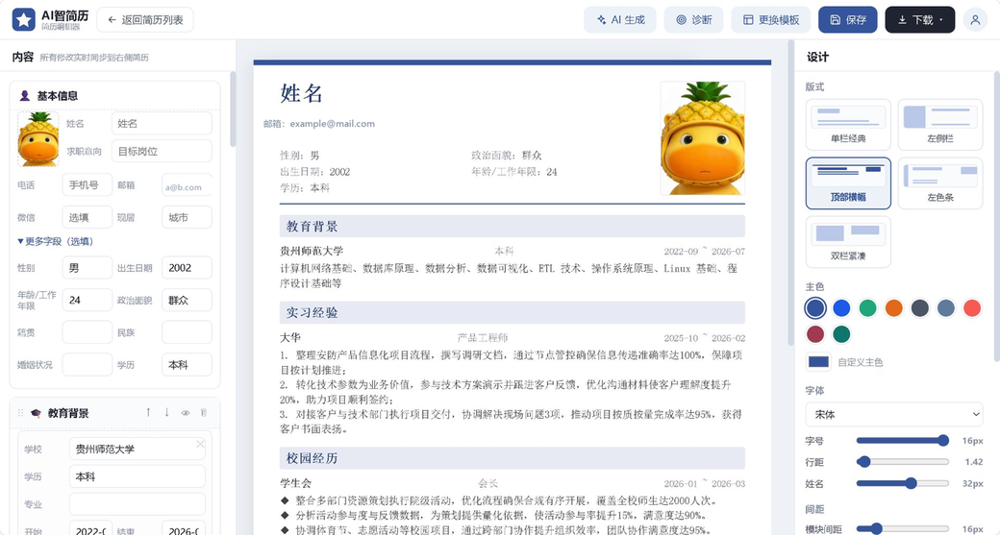

# 智简历 · AI 简历优化与排版系统

> 本地部署的简历写作工具：**内容填一遍，版式随便换，一键导出 Word / PDF / 长图。**

基于 FastAPI + LLM 构建，核心设计是**把「简历内容」和「版式模板」彻底拆开**——求职者只负责把真实经历填对，AI 负责把表达打磨到位，系统负责排版和导出。换模板不丢内容，改配色不影响结构。

<p align="center"></p>

<p align="center"></p>

---

## 一、为什么这么设计

传统简历工具把文字写进 Word 模板里，换个模板就得重写一遍；在线工具又把内容锁死在自家服务器上。

智简历的做法是把简历抽象成一份**统一的 JSON**：

```
简历 = 内容 { basic, modules[], order, hidden }  +  主题 { family, theme, primary, 字号/行距/版心/头像 … }
```

内容只有一份，版式和配色全是**渲染层参数**。同一个「渲染引擎」同时驱动三处，保证三处结果一致：

| 渲染目标 | 实现 |
| --- | --- |
| 中间 A4 实时预览 | `resume-render.js/.css`（参数化 DOM 渲染） |
| Word 导出 | `utils/resume_docx.py`（python-docx 做 OOXML 级排版，不用 Word 模板套壳） |
| PDF / 长图 | Word COM 转 PDF → PyMuPDF 拼长图 |

---

## 二、功能

### 编辑器（三栏所见即所得）

- **左栏表单**：教育 / 实习 / 工作 / 项目 / 校园 / 技能 / 荣誉 / 自我评价 / 兴趣，条目增删、上下移动、拖拽排序、模块显隐
- **中间 A4 预览**（794×1123，与打印同尺度）：支持**点击直改**，页面上直接编辑文字，与表单双向同步
- **右栏设计面板**
  - **5 种版式族**：单栏经典 / 左侧栏 / 顶部横幅 / 左色条 / 双栏紧凑
  - **9 套配色 + 自定义主色**，5 种中文字体
  - 字号、行距、姓名字号、模块间距、版心留白、头像大小与形状（方框 / 圆框）
  - **6 种标题样式**：下划线 / 左侧竖线 / 浅底横条 / 实心横条 / 标题+延伸线 / 纯文字
  - **纸面**：页面底色、正文色、模块图标开关
  - **10 套开箱预设**（如「简约灰蓝 · 横条」「简约风 · 左色条」），一键套用后再微调
- **年月点选面板**：所有时间段字段点选 `« 年份 »` + 十二宫格，起止双框、单选一侧即单值
- **双通道自动保存**：浏览器本地兜底 + 云端草稿 3 秒同步，旧格式草稿自动迁移；登录即可用，无 VIP 门禁

### AI 能力

- **条目级优化**：每条经历描述旁「AI 优化」，粘贴目标岗位 JD 后按 STAR 量化改写，原文/结果对照、确认后替换
- **整份生成 / 整份优化**：`/api/optimize-experience-self`（JD 拆解 + 经历改写 + 自我评价定制）
- **简历诊断**：ATS 体检 + 岗位匹配度打分
- 限流保护：登录 10 次 / 5 分钟、AI 接口 5 次 / 小时，防止 Key 被刷

### 导出

- 结构化导出 `/api/export/{docx,pdf,png}`：**头像大小、页面底色、正文色、标题样式全部跟随编辑器设置**，不是简单截图
- 长图导出为纵向拼接 PNG，适合直接贴到招聘平台
- 模板保真链路（管理端）：Word 模板解析为带坐标的盒子，就地替换文字保留原格式，内容变长自动缩小字号防溢出

### 管理后台

- 模板上传 / 批量导入 / 审核上架 / 批量管理，操作留痕
- **可视化模板编辑器**：整页底图 + 盒子图层，拖拽移动、八向缩放、增删文本框、调字体颜色对齐；保存后布局覆盖即时生效

---

## 三、技术栈

| 分类 | 技术 |
| --- | --- |
| 后端 | FastAPI + Uvicorn、Pydantic |
| 数据库 | MySQL 8（PyMySQL） |
| LLM | OpenAI 兼容 SDK（智谱 GLM / MiMo） |
| 文档处理 | python-docx（OOXML 级操作）、PyMuPDF、pdfplumber、pdf2docx、docx2pdf |
| 图像 | Pillow、OpenCV（YuNet 人脸检测）、Tesseract OCR |
| 前端 | 原生 HTML/CSS/JS，零重型框架（自研参数化渲染引擎 + 交互组件） |

---

## 四、项目结构

```
├── resume_optimizer/            # 主应用
│   ├── main.py                  # FastAPI 入口（路由 / 鉴权 / 导出 / 结构合并）
│   ├── requirements.txt
│   ├── .env.example             # 配置模板（复制为 .env 使用）
│   ├── 启动.bat / 停止.bat       # Windows 一键启停
│   ├── utils/
│   │   ├── resume_docx.py       # 结构化简历 → Word 生成器 + PDF→PNG 长图
│   │   ├── template_editor.py   # 模板盒子解析 / 文本写回 / 新增盒子注入
│   │   ├── ratelimit.py         # 接口限流
│   │   ├── db.py / auth.py / parser.py / converter.py / llm.py / ...
│   ├── static/
│   │   ├── editor.html + editor-v3.js/.css   # 三栏编辑器
│   │   ├── resume-render.js/.css             # 参数化 A4 渲染引擎
│   │   ├── template-editor.html              # 管理端可视化模板编辑器
│   │   └── admin.html                        # 管理后台
│   ├── quality/                 # ATS 检查、岗位匹配打分
│   └── tools/smoke_v3.py        # 自检脚本
├── auto_test/                   # 批量回归测试脚本
├── docs/                        # 截图
└── 项目技术说明.md               # 架构与实现说明
```

---

## 五、快速开始

### 环境要求

- Python 3.9+、MySQL 8
- （PDF 导出）本机安装 Microsoft Word —— 依赖 Word COM 组件
- （OCR）安装 [Tesseract OCR](https://github.com/tesseract-ocr/tesseract) 并配置中文语言包
- （AI 能力）可访问智谱 GLM API（经历/自我评价优化用 `glm-4-flash-250414`，免费）

### 部署

```bash
# 1. 安装依赖
cd resume_optimizer
pip install -r requirements.txt

# 2. 配置环境变量
cp .env.example .env          # 填入 LLM API Key、数据库密码、管理员密码

# 3. 初始化数据库（先在 MySQL 建好 .env 里配置的库）
python -c "from utils import db"

# 4. 启动
python -m uvicorn main:app --host 0.0.0.0 --port 8000    # 或 Windows 双击 启动.bat
```

访问 <http://localhost:8000>：游客可直接浏览模板中心，登录/注册为首页内置弹窗；编辑器入口 `/static/editor.html`（需登录）。

### 环境变量

| 变量 | 说明 |
| --- | --- |
| `OPENAI_API_KEY` / `OPENAI_BASE_URL` | 内容优化主模型（OpenAI 兼容格式） |
| `GLM_API_KEY` | 智谱 GLM Key（编辑器 AI 生成） |
| `EXP_OPT_API_KEY` / `EXP_OPT_MODEL` | 经历/自我评价优化（默认 `glm-4-flash-250414`） |
| `DB_HOST` / `DB_USER` / `DB_PASSWORD` / `DB_NAME` | MySQL 连接配置 |
| `ADMIN_PASSWORD` | 管理后台密码 |

---

## 六、自检

```bash
cd resume_optimizer
python tools/smoke_v3.py
# 6 项：端点增删 / editor_boxes 结构合并 / JS 语法与引用 / docx→pdf→长图真实往返 / 盒子注入 / 配色派生
```

---

## 七、更新日志

### 2026-10 · 版式与导出一致性

- 新增版式族「**左色条**」：左侧主色竖条 + 大号姓名（不压底色）+ 两列信息 + 右上照片
- 「顶部横幅」重做：去掉整块深色底，改为页顶细色带 + 白底头部
- 新增标题样式「实心横条」「标题+延伸线」，新增配色「珊瑚红」
- 新增纸面参数：页面底色、正文色、模块图标开关
- 修复：头像大小滑块对 Word 无效；头部信息与照片高度不齐导致的空白带
- 修复：Word 单元格段前距导致表格行跨页；相邻段落边框被合并导致分隔线消失

### 编辑器重构

- 统一 JSON 数据模型 + 三栏布局 + 点击直改，换模板零丢失
- 新增结构化解出链路 `/api/export/{docx,pdf,png}`
- 管理端可视化模板编辑器，布局覆盖 + 新增盒子即时下发
- 移除 VIP 门禁（登录即可用），时间字段全面升级为年月点选面板

---

## 八、说明

- **隐私**：仓库不包含任何真实简历数据。`.env`、运行时草稿、导出产物、用户上传的模板原件均在 `.gitignore` 中排除；README 截图已做脱敏处理
- 本项目仅用于学习与个人求职辅助
